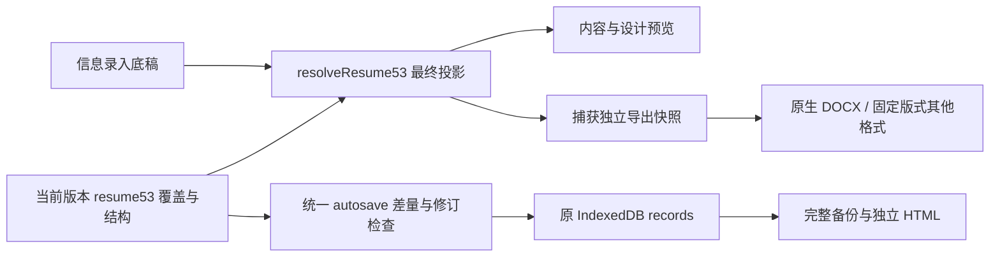

# 启程 5.3.0 本地交付报告

> 2026-10-30 已完成界面修订，最新界面和逐项说明见 [UI_5.3.md](UI_5.3.md)。底层数据模型保持兼容。

## 工程范围与基线

最新完整本地基线为同级 `qicheng-5.2.1-optimized`。开发在独立 `qicheng-5.3` 中进行，没有覆盖基线、sources 同步参考资料或其他开发目录。没有执行 push、Release、Pages 或线上部署。当前交付是本地完整工程，正式发布仍等待用户指令。

实际检查确认 5.2.1 已具备逐题拆行、稳定来源身份、增量事务、本地修改冲突保护、个人批注、学习快照、Blob 原件和无缩略图模式。本版延续这些实现；数据库仍为 qicheng-v4 / v2 / records，没有另建一套数据库或保存机制。

## 简历模型与数据流

旧版本保留原 ID、导出参数、顺序、选择、文件名和摘要。首次迁移添加 resume53，迁移幂等并保留真实时间信息。母版来自信息录入；版本保存字段覆盖、标签、隐藏、局部样式、三级顺序、自定义结构、封面目录和模板参数。未覆盖字段继承底稿，显式空字符串是独立内容。

修改版本不写母版；版本之间不共享可变内容覆盖。删除底稿条目前记录最新回退，删除资料文件前检查版本引用。旧目标院校覆盖、四类独立表述和可选优先级已纳入迁移。跨标签页同时编辑时沿用工作区 CAS，后写旧窗口明确失败并保留本地待保存内容；不会自动合并不同版本的并发编辑。

管理中心展示最近修改与全部版本，创建/复制/改名/多院校及双重确认删除。全屏编辑器支持内容与设计切换、三级选择、显式排序、触控按钮、结构化模块、局部样式、确认恢复、有限会话撤销重做和真实事务保存状态。空白版本采用空白快照；对空白版本执行恢复是复制当时母版值，不自动订阅后续母版修改。

四套模板共享解析与导出引擎。原始模板关闭装饰但保留其他模板参数。统一导出中心保留版本、文件名、格式、预览、旧检查和高级设置，保存失败不生成旧内容。DOCX 为原生标题/段落/图片与分栏，自然流动分页；PDF/PPTX/HTML/PNG/Markdown 同样使用当前版本内容。详见 RESUME_MODEL_5.3.md 与 EXPORT_5.3.md。

## 学习数据与接口复用

| 数据 | 现有/扩展存储 |
| --- | --- |
| 题库元数据 | @521:bank:meta:<origin>:<pack> |
| 单题 | @521:bank:q:<origin>:<pack>/<question> |
| 本地来源与冲突保护 | question:edit:* |
| 个人批注 | question:note:<source-pack>/<question> |
| 学习状态 | quiz:mark:<source-pack>/<question>，增加掌握/待复习/最近错题时间 |
| 练习历史与草稿 | quiz:record:* / quiz:draft:active，历史含原题快照与原评分 |
| 收藏夹 | learning:folder:<stable-id>，独立多对多题目身份 |
| 首页概要 | settings:learning-overview53，不含全部题目或历史快照 |
| 设备模式与启动偏好 | meta:device-preferences53，完整备份不跨设备携带 |

稳定身份以来源题包 + 题目 ID 定位，展示题库与题包归属仍使用原目录。管理页调用既有 readQuestion/createQuestion/updateQuestion/deleteQuestion/queryQuestions/ensureManualQuestionPack/exportQuestionBank；批量 JSON/补丁继续使用 prepareResourceImport/applyPreparedResourceImport。采用导入版本的冲突选择和移除本地来源标记在同一事务提交，失败原子回滚。

错题按身份去重、掌握与收藏独立、多收藏夹、筛选复习、共享独立笔记、单题管理、历史分页、7/30/全部统计已实现。未交卷保护覆盖详情、历史、搜索和跨窗口笔记；再次答错重开待复习。标准答案后改不改变历史评分。备份包括新增字段、笔记和收藏夹；失败笔记可从内存进入救援备份。

## 加载与交互

PWA 首页只读工作区及学习概要，不读所有题目/附件/历史。resume53/export53/learning53/search53 按实际路由加载；文档库由 ensureVendors 按需执行。完整与精简模式均复用这些按需机制，所以两者首页资源接近，精简模式主要避免后续复杂工作区初始化，并非简单用 CSS 隐藏已运行的编辑器。

单文件 HTML 将程序与库源代码内嵌，体积会大于 PWA 首页；文档库保存在惰性 script 数据块，使用到时才执行，首页没有文档库全局对象。原图和附件继续保留 Blob 原文、列表无缩略图，打开或导出时读取。首次离线资源准备会预缓存所有核心资源，这是后台下载，不代表页面已经初始化所有模块。

自动模式以实际宽度/方向判定，手机默认精简；宽度不足时即使手动完整版也转简历只读审阅。横屏平板支持完整编辑。设置六类分区保留原有控制项，切换模式前等待保存。搜索按来源分组、高亮并精确跳转，活动未交卷题目的答案和笔记不会返回；数据变化立即清理结果并自动重新查询。

## 测试与性能证据

最终测试计数、原始路径及平台边界见 ../TEST_REPORT.md。性能使用同一台 Windows Edge、同视口、同一 5000 题夹具交替测量基线/完整/精简，各三次；详见 PERFORMANCE_5.3.md 和 JSON 原始记录。没有使用推测填充数值。

发现并修复的关键问题包括旧历史重叠题组提前显示解析、详情路由保存校验、删除底稿后最新文本回退、旧版本特殊字段迁移、平板全屏布局、旧高级导出配置遗漏、隐藏附件 HTML 泄漏、单文件库启动执行及后台保存取消搜索。

## 限制与后续建议

- 实际平台为 Windows Edge 无头浏览器。手机/平板、触控是模拟；未在实体 iPad、Android、Mac 或安装后的 OS PWA 外壳上测试。
- DOCX 八份文件完成 OOXML/原生文字图片/分栏/无保护检查，未在 Word、WPS 或 LibreOffice 桌面中人工编辑和重新保存。字体和自然分页可能因软件变化，目录页码需更新域。
- 撤销为当前会话有限栈，刷新后保留最终内容但不保留撤销历史。跨窗口采用拒绝旧写入，不自动融合多人的编辑。
- 搜索为按需分页扫描，统计显式进入后读取历史；极大量历史和题库需继续测量再添加摘要或索引。连续 20 组答题是合成重复操作验收，不代表数小时真机运行。
- 版本回退复制必要文本元数据；单版本更新仍写该版本记录，不逐字拆行。原图和文件不会复制到每份版本。
- 浏览器数据仍受站点空间与系统清理政策影响；沿用原持久存储申请与完整外部备份。不同地址/端口/浏览器不共享资料。

后续约定见 MAINTENANCE_5.3.md。先做局部维护，保持永久 ID、迁移幂等、原子保存和备份可恢复；未经用户新指令不进行发布。
